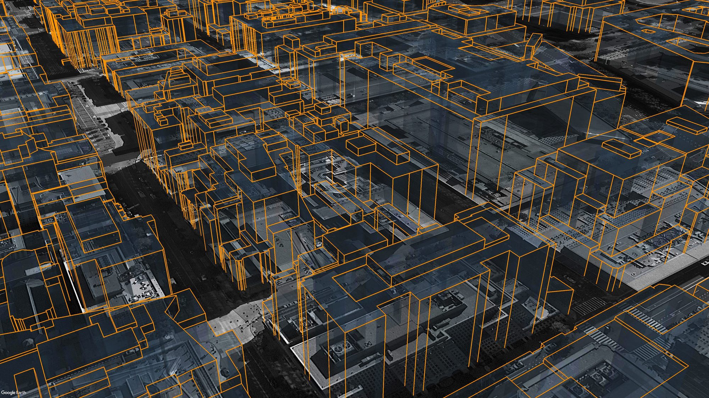

---
hide:
  - toc
---

<div class="kmlb-hero" markdown>
<div class="kmlb-hero__eyebrow">Build KML files in plain Python</div>
<h2 class="kmlb-hero__title">KMLB Docs</h2>
<p class="kmlb-hero__sub">KMLB is a dependency-free Python KML builder for Google Earth. Write points, lines, polygons, styles, and folders in plain Python, then assemble them into a complete <b><code>.kml</code></b></p><br>
<p class="kmlb-hero__sub">New to KMLB? Check out our <a href="reference/getting_started/">Quick Start Guide</a> and a <a href="tutorial/">tutorial</a> that builds a KML of Boston waterfront attractions step by step.</p>
</div>

---

## Example KML Script

Each feature is a single Python call that returns a KML element. Create features,
give them styles, and gather them into a document to write to disk. That is the
whole workflow.

```python
import kmlb

# CREATE A POINT
fountain = kmlb.point([-71.051904, 42.358988, 0], "Rings Fountain")

# WRITE KML FILE
kmlb.kml(
    "Boston Fountain",  # KML name
    [fountain],         # Features
    path="folder/boston_fountain.kml"  # Export path
)
```
<br>
## Example 3D Output

[](assets/img/3d-buildings.jpg){ .glightbox }

<p class="kmlb-caption">Building footprints extruded into 3D and viewed in Google&nbsp;Earth, built with kmlb polygons.</p>

---
<br>

<div class="kmlb-hero" markdown>
<div class="kmlb-hero__eyebrow">Reference</div>
<h2 class="kmlb-hero__title">Function references</h2>
<p class="kmlb-hero__sub">Every kmlb function, grouped by what it does. Follow any link for its full signature, parameters, and worked examples.</p>
</div>

## Features

Build placemarks from coordinates or a search, ready to drop into a folder or document.

| Function | Description                                                                 |
|---|-----------------------------------------------------------------------------|
| [`point`](reference/features.md#point) | Point placemark from a `[lon, lat]` (or `[lon, lat, elev]`) coordinate set. |
| [`search_poi`](reference/features.md#search_poi) | Placemark located by an address or search string, geocoded by Google Earth. |
| [`street_view`](reference/features.md#street_view) | Point placemark built from a Google Maps Street View URL that opens that panorama. |
| [`line`](reference/features.md#line) | Line or polyline from an ordered list of coordinates.                       |
| [`polygon`](reference/features.md#polygon) | Polygon from one or more rings (first ring outer, the rest holes).          |

## Styles

Define a reusable style once, name it, and reference it from a feature's `style_to_use`.

| Function | Description |
|---|---|
| [`point_style`](reference/styles.md#point_style) | Reusable point style: icon, color, scale, and label. |
| [`line_style`](reference/styles.md#line_style) | Reusable line style: color and width. |
| [`polygon_style`](reference/styles.md#polygon_style) | Reusable polygon style: fill and outline. |

## Views & Export

Group features, set the camera, and write the document.

| Function | Description |
|---|---|
| [`folder`](reference/views_export.md#folder) | Group features and other folders together. |
| [`kml`](reference/views_export.md#kml) | Assemble features and styles into a KML document and write it to disk. |
| [`look_at`](reference/views_export.md#look_at) | Camera angle and view that orbits a target, for a feature or document. |
| [`camera`](reference/views_export.md#camera) | Camera viewpoint (eye position and aim) for a feature or document. |
| [`networklink_kml`](reference/views_export.md#networklink_kml) | Network-link KML that refreshes from a hosted URL. |

## Geodesy

Measure and project on the WGS-84 ellipsoid.

| Function | Description |
|---|---|
| [`distance`](reference/geodesy.md#distance) | Distance in meters between two coordinates. |
| [`bearing`](reference/geodesy.md#bearing) | Initial bearing in degrees between two coordinates. |
| [`destination`](reference/geodesy.md#destination) | Coordinate reached from an origin along a bearing and distance. |

## Shapes

Higher-level geometry built on the core builders.

| Function | Description |
|---|---|
| [`circle`](reference/shapes.md#circle) | Circle polygon of a given radius around a point. |
| [`ellipse`](reference/shapes.md#ellipse) | Ellipse polygon from two semi-axes and an orientation. |
| [`rectangle`](reference/shapes.md#rectangle) | Rectangle polygon anchored at an upper-left corner, rotatable by azimuth. |
| [`ngon`](reference/shapes.md#ngon) | Regular-polygon (triangle, pentagon, hexagon, ...) around a point. |
| [`annulus`](reference/shapes.md#annulus) | Filled ring polygon (an outer circle with a hole). |
| [`arc`](reference/shapes.md#arc) | Range-of-reach arc drawn as a line. |
| [`wedge`](reference/shapes.md#wedge) | Pie-wedge (circular sector) polygon, a natural fit for cellular coverage. |
| [`ribbon`](reference/shapes.md#ribbon) | Buffered polygon around a path; even or per-point width. |
| [`con_rings`](reference/shapes.md#con_rings) | Folder of range-ring outlines from a list or a start/interval/count series. |
| [`fishnet`](reference/shapes.md#fishnet) | Folder of rectangular grid cells from a corner; clickable, id-able. |
| [`hex_grid`](reference/shapes.md#hex_grid) | Folder of tessellated hexagonal grid cells from a corner. |
| [`hex_field`](reference/shapes.md#hex_field) | Folder of hexagonal cells in a hexagon-shaped cluster of rings around a center; cells numbered outward from the center. |
| [`fresnel_zone`](reference/shapes.md#fresnel_zone) | 3D Fresnel-zone tube plus line-of-sight path for a point-to-point radio link. |
| [`cylinder`](reference/shapes.md#cylinder) | 3D cylinder volume (or a frustum via `top_radius`); orientable along any axis. |
| [`cone`](reference/shapes.md#cone) | 3D cone; apex or base anchored, orientable along any axis. |
| [`dome`](reference/shapes.md#dome) | 3D hemisphere dome (or bowl when inverted). |
| [`sphere`](reference/shapes.md#sphere) | 3D sphere; anchor by center or a pole. |
| [`cube`](reference/shapes.md#cube) | 3D cube or rectangular box. |
| [`pyramid`](reference/shapes.md#pyramid) | 3D pyramid with an n-sided base. |
| [`soccer_ball`](reference/shapes.md#soccer_ball) | 3D truncated icosahedron, two-tone. |

## Colors & Icons

Name colors and markers instead of hunting down hex tuples and icon URLs.

| Function | Description |
|---|---|
| [`colors`](reference/colors_icons.md) | Named color palette (`colors.RED`, or `color="red"`). |
| [`icons`](reference/colors_icons.md) | Built-in marker shorthands (`icon="triangle"`, `"red-paddle"`). |

<br><br><br><br><br>