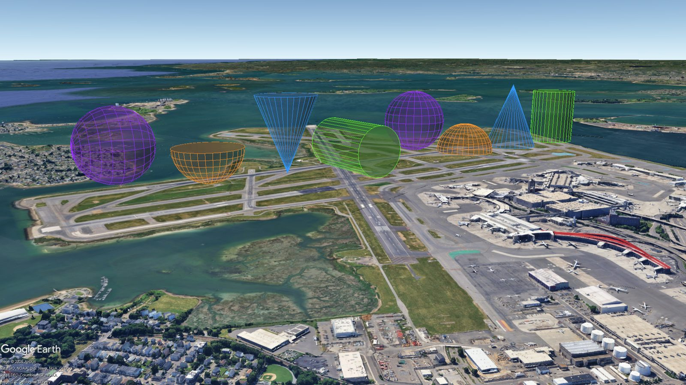
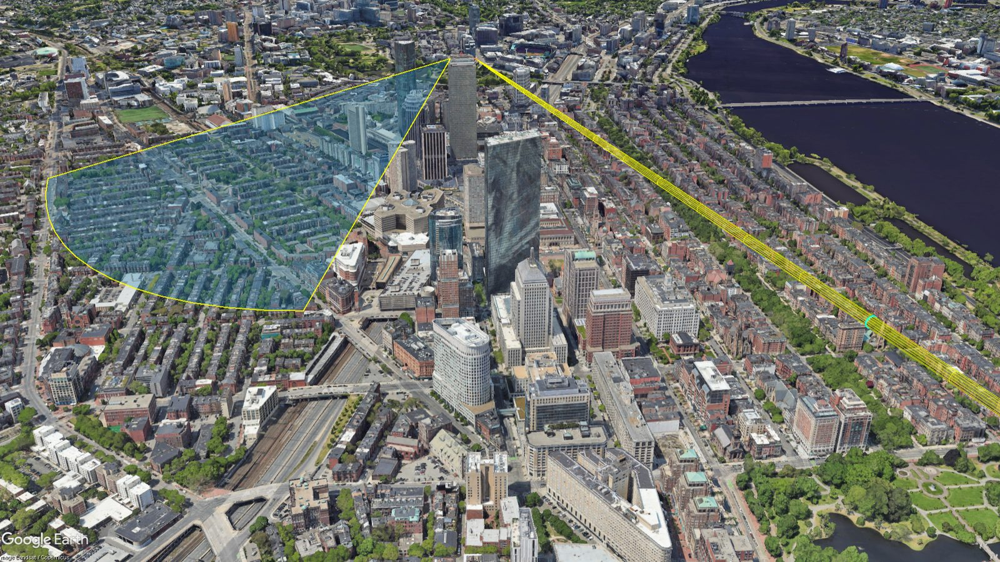

<div class="kmlb-hero" markdown>
<div class="kmlb-hero__eyebrow">Reference</div>
<h2 class="kmlb-hero__title">Shapes</h2>
<p class="kmlb-hero__sub">Higher-level geometry builders: the 2D shapes <code>circle</code>, <code>ellipse</code>, <code>rectangle</code>, <code>ngon</code>, <code>annulus</code>, <code>arc</code>, <code>wedge</code>, <code>corridor</code>, <code>concentric_rings</code>, and <code>grid</code>; the 3D solids <code>cylinder</code>, <code>cone</code>, <code>dome</code>, and <code>sphere</code>; and <code>fresnel_zone</code> (a radio link's 3D Fresnel tube).</p>
</div>

## Sample files

[](../assets/img/3d-shapes.jpg){ .glightbox .crop-3d }

<p class="kmlb-caption">3D Shapes from <code>kmlb.shapes</code> in Google&nbsp;Earth. Grab the sample KMLs and explore.</p>

<div class="kmlb-downloads" markdown>
[Download shapes_2d.kml](../assets/shapes_2d.kml){ .md-button .kmlb-download download="shapes_2d.kml" }
[Download shapes_3d.kml](../assets/shapes_3d.kml){ .md-button .kmlb-download download="shapes_3d.kml" }
[Download rf_scene.kml](../assets/rf_scene.kml){ .md-button .kmlb-download download="rf_scene.kml" }
</div>

## 2D shapes

These builders return flat KML geometry composed from the core
[`polygon`](features.md#polygon), [`line`](features.md#line), and
[`folder`](views_export.md#folder) primitives. Unless you pass a `z_mode` they
clamp to the ground and follow the terrain, so a 2-element `[lon, lat]` center
works fine. Every builder forwards extra keyword arguments (`z_mode`,
`style_to_use`, `hidden`, `headers`, `attrs`, ...) to its underlying primitive.

### circle

Approximates a circle of a given radius (meters) with a regular polygon of
`steps` vertices projected across the WGS-84 ellipsoid.

```python
circle(center, radius, *, steps=48, name="Circle", **kwargs) -> Element
```

| Parameter | Type | Default | Description |
|---|---|---|---|
| `center` | `list[float]` | required | `[lon, lat]` or `[lon, lat, z]` center. |
| `radius` | `float` | required | Radius in meters. |
| `steps` | `int` | `48` | Vertices around the circle; more gives a smoother edge. |
| `name` | `str` | `'Circle'` | Placemark name. |
| `**kwargs` | | | Any keyword argument accepted by [`polygon`](features.md#polygon). |

!!! success "Returns"
    `Element`: a KML `Placemark` containing the circle `Polygon`.

```python
# A 37.5 m circle around the Parkman Bandstand on Boston Common.
kmlb.shapes.circle([-71.065510, 42.354345, 0], 37.5)
```

### ellipse

Builds an ellipse from its two semi-axis lengths (meters) and an orientation. At
`orient=0` the major axis runs north-south; increasing `orient` rotates it
clockwise from true north.

```python
ellipse(center, semi_major, semi_minor, *, orient=0.0, steps=64,
        name="Ellipse", **kwargs) -> Element
```

| Parameter | Type | Default | Description |
|---|---|---|---|
| `center` | `list[float]` | required | `[lon, lat]` or `[lon, lat, z]` center. |
| `semi_major` | `float` | required | Half the long-axis length, in meters. |
| `semi_minor` | `float` | required | Half the short-axis length, in meters. |
| `orient` | `float` | `0.0` | Clockwise rotation of the major axis, degrees from true north. |
| `steps` | `int` | `64` | Vertices around the ellipse. |
| `name` | `str` | `'Ellipse'` | Placemark name. |
| `**kwargs` | | | Any keyword argument accepted by [`polygon`](features.md#polygon). |

!!! success "Returns"
    `Element`: a KML `Placemark` containing the ellipse `Polygon`.

```python
# A ~1200 m x 660 m ellipse off Point Shirley / Yirrell Beach, Winthrop, tilted 18 deg west of north.
kmlb.shapes.ellipse([-70.964514, 42.360287, 0], 600, 330, orient=-18)
```

### rectangle

Builds a rectangle centered on a point. At `orient=0` `width` runs east-west and
`height` runs north-south; `orient` turns it clockwise from true north.

```python
rectangle(center, width, height, *, orient=0.0, name="Rectangle", **kwargs) -> Element
```

| Parameter | Type | Default | Description |
|---|---|---|---|
| `center` | `list[float]` | required | `[lon, lat]` or `[lon, lat, z]` center. |
| `width` | `float` | required | East-west size at `orient=0`, in meters. |
| `height` | `float` | required | North-south size at `orient=0`, in meters. |
| `orient` | `float` | `0.0` | Clockwise rotation, degrees from true north. |
| `name` | `str` | `'Rectangle'` | Placemark name. |
| `**kwargs` | | | Any keyword argument accepted by [`polygon`](features.md#polygon). |

!!! success "Returns"
    `Element`: a KML `Placemark` containing the rectangle `Polygon`.

```python
# A dock apron on the East Boston waterfront, sized from two opposite corners.
nw, se = [-71.029345, 42.341506], [-71.014013, 42.339864]     # NW and SE corners
center = [(nw[0] + se[0]) / 2, (nw[1] + se[1]) / 2, 0]
width = kmlb.distance([nw[0], center[1]], [se[0], center[1]])   # ~1260 m east-west
height = kmlb.distance([center[0], nw[1]], [center[0], se[1]])  # ~185 m north-south
kmlb.shapes.rectangle(center, width, height)
```

### ngon

Builds a regular polygon of `sides` equal edges, each vertex `radius` meters from
the center. `orient` turns it clockwise; at `orient=0` the first vertex points due
north.

```python
ngon(center, radius, sides, *, orient=0.0, name="Polygon", **kwargs) -> Element
```

| Parameter | Type | Default | Description |
|---|---|---|---|
| `center` | `list[float]` | required | `[lon, lat]` or `[lon, lat, z]` center. |
| `radius` | `float` | required | Distance from center to each vertex, in meters. |
| `sides` | `int` | required | Number of sides (3 = triangle, 5 = pentagon, 6 = hexagon). |
| `orient` | `float` | `0.0` | Clockwise rotation of the first vertex, degrees from true north. |
| `name` | `str` | `'Polygon'` | Placemark name. |
| `**kwargs` | | | Any keyword argument accepted by [`polygon`](features.md#polygon). |

!!! success "Returns"
    `Element`: a KML `Placemark` containing the regular-polygon `Polygon`.

!!! failure "Raises"
    `ValueError` if `sides` is less than 3.

```python
# A pentagon over Fort Independence, the five-bastioned fort on Castle Island.
kmlb.shapes.ngon([-71.011100, 42.338233, 0], 100, 5)
```

### annulus

Builds a filled ring: an outer circle with a smaller concentric inner circle
punched out as a hole.

```python
annulus(center, outer_radius, inner_radius, *, steps=48, name="Annulus", **kwargs) -> Element
```

| Parameter | Type | Default | Description |
|---|---|---|---|
| `center` | `list[float]` | required | `[lon, lat]` or `[lon, lat, z]` center. |
| `outer_radius` | `float` | required | Outer edge radius, in meters. |
| `inner_radius` | `float` | required | Inner (hole) radius, in meters; must be smaller than `outer_radius`. |
| `steps` | `int` | `48` | Vertices around each circle. |
| `name` | `str` | `'Annulus'` | Placemark name. |
| `**kwargs` | | | Any keyword argument accepted by [`polygon`](features.md#polygon). |

!!! success "Returns"
    `Element`: a KML `Placemark` containing a `Polygon` with one hole.

!!! failure "Raises"
    `ValueError` if `inner_radius` is not smaller than `outer_radius`.

```python
# A 100 m-wide band (inner 160 m, outer 260 m) around Snake Island, Winthrop.
kmlb.shapes.annulus([-70.979528, 42.365842, 0], 260, 160)
```

### arc

Draws a curved path at a fixed radius from a center point, sweeping from
`start_az` to `end_az` (degrees from true north). Handy for range-of-reach arcs
and fields of fire. Returns a line, not a filled sector (use
[`wedge`](#wedge) for a filled sector).

```python
arc(center, radius, start_az, end_az, *, steps=32, name="Arc", **kwargs) -> Element
```

| Parameter | Type | Default | Description |
|---|---|---|---|
| `center` | `list[float]` | required | `[lon, lat]` or `[lon, lat, z]` center. |
| `radius` | `float` | required | Arc radius, in meters. |
| `start_az` | `float` | required | Starting azimuth, degrees from true north. |
| `end_az` | `float` | required | Ending azimuth, degrees from true north. |
| `steps` | `int` | `32` | Segments along the arc. |
| `name` | `str` | `'Arc'` | Placemark name. |
| `**kwargs` | | | Any keyword argument accepted by [`line`](features.md#line). |

!!! success "Returns"
    `Element`: a KML `Placemark` containing the arc `LineString`.

```python
# A field-of-fire arc for Fort Warren on Georges Island: a 550 m reach sweeping
# the harbor approach from north-east (46 deg) through south-east to south (172 deg).
kmlb.shapes.arc([-70.9285, 42.3199, 0], 550, 46, 172)
```

### wedge

Builds a pie-wedge-shaped polygon: a circular sector centered on a point, opening
toward an azimuth, with a given angular width and radius. The arc is approximated
with `steps` vertices projected across the WGS-84 ellipsoid.

A wedge maps naturally onto a cellular coverage sector, which makes it a handy
way to illustrate cell-tower coverage. The `azimuth` is the direction the antenna
faces, the `width` is the sector's beamwidth, and the `radius` is its reach, so
the shape visualizes sector width, direction, and reach at a glance.

```python
wedge(center, azimuth, width, radius, *, tilt=0.0, steps=15, name="Wedge", **kwargs) -> Element
```

| Parameter | Type | Default | Description |
|---|---|---|---|
| `center` | `list[float]` | required | `[lon, lat, elev]` origin of the wedge. |
| `azimuth` | `float` | required | Direction the center of the arc points, degrees from true north. |
| `width` | `float` | required | Angular width of the wedge, in degrees. |
| `radius` | `float` | required | Length of the wedge's straight edges, in meters. |
| `tilt` | `float` | `0.0` | Elevation tilt of the whole sector, in degrees: `0` is flat on the ground, `-90` points it straight down, `90` straight up. See the note below. |
| `steps` | `int` | `15` | Number of vertices along the arc; more steps give a smoother curve. |
| `name` | `str` | `'Wedge'` | Placemark name. |
| `**kwargs` | | | Any keyword argument accepted by [`polygon`](features.md#polygon) (e.g. `z_mode`, `style_to_use`, `hidden`, `headers`, `attrs`). |

!!! success "Returns"
    `Element`: a KML `Placemark` containing the wedge `Polygon`.

!!! note
    By default `wedge` fills `headers`/`attrs` with the wedge's defining
    parameters (azimuth, width, radius, tilt, steps, and center). Pass your own
    `headers`/`attrs` to override them.

!!! note "Tilt and altitude"
    A tilt lifts the sector off the ground, so it only renders under a
    non-clamped altitude mode. When `tilt` is nonzero and no `z_mode` is given,
    `wedge` selects `'ABS'` (absolute) automatically and treats the center's `z`
    as an absolute (MSL) altitude. Pass an explicit `z_mode` (for example
    `z_mode='RTG'` to measure from the ground) to override.

**Examples**

A wedge opening due east

```python
# A 30°-wide wedge of radius 1 km, opening due east from a center point.
w = kmlb.shapes.wedge([-71.0589, 42.3601, 0], azimuth=90, width=30, radius=1000)
```

An antenna sector with 6° of down-tilt

```python
# The center z is an absolute altitude (antenna height above sea level); the
# sector tilts 6° below horizontal. z_mode defaults to 'ABS' when tilted.
w = kmlb.shapes.wedge([-71.0589, 42.3601, 45], azimuth=90, width=30, radius=1000, tilt=-6)
```

### corridor

Buffers an open path into a polygon of constant `width` by offsetting each vertex
along the bisector of its turn (a miter join), so the corridor keeps an even
width through bends. Useful for trails, rail lines, pipelines, and flight
corridors.

```python
corridor(path, width, *, name="Corridor", **kwargs) -> Element
```

| Parameter | Type | Default | Description |
|---|---|---|---|
| `path` | `list[list[float]]` | required | Ordered `[lon, lat]` (or `[lon, lat, z]`) vertices, 2 or more. |
| `width` | `float` | required | Total corridor width, in meters. |
| `name` | `str` | `'Corridor'` | Placemark name. |
| `**kwargs` | | | Any keyword argument accepted by [`polygon`](features.md#polygon). |

!!! success "Returns"
    `Element`: a KML `Placemark` containing the corridor `Polygon`.

!!! failure "Raises"
    `ValueError` if `path` has fewer than 2 points.

```python
# A 45 m-wide corridor down a path along the Rose Kennedy Greenway.
path = [
    [-71.051781, 42.358581], [-71.051176, 42.356909],
    [-71.051159, 42.356408], [-71.051254, 42.355748],
    [-71.051645, 42.355150], [-71.051895, 42.354950],
    [-71.053736, 42.353987],
]
kmlb.shapes.corridor(path, 45)
```

### concentric_rings

Draws one unfilled circle outline per radius and returns them in a folder, so each
ring toggles on its own. Give the radii explicitly as `radii`, or generate an
evenly spaced series with `start`, `interval`, and `count`.

```python
concentric_rings(center, radii=None, *, start=None, interval=None, count=None,
                 steps=48, name="Range Rings", collapsed=True, hidden=False,
                 **kwargs) -> Element
```

| Parameter | Type | Default | Description |
|---|---|---|---|
| `center` | `list[float]` | required | `[lon, lat]` or `[lon, lat, z]` center all rings share. |
| `radii` | `list[float]` | `None` | Explicit radius for each ring, in meters. If omitted, built from `start`/`interval`/`count`. |
| `start` | `float` | `None` | Innermost ring radius, in meters (generator form). |
| `interval` | `float` | `None` | Spacing between successive rings, in meters (generator form). |
| `count` | `int` | `None` | Number of rings to generate (generator form). |
| `steps` | `int` | `48` | Vertices around each ring. |
| `name` | `str` | `'Range Rings'` | Folder name. |
| `collapsed` | `bool` | `True` | Whether the folder starts collapsed in the places panel. |
| `hidden` | `bool` | `False` | Whether the folder starts hidden. |
| `**kwargs` | | | Any keyword argument accepted by [`line`](features.md#line); applied to every ring. |

!!! success "Returns"
    `Element`: a KML `Folder` of line rings.

!!! failure "Raises"
    `ValueError` if neither `radii` nor all of `start`, `interval`, and `count` are given.

```python
# Five range rings at 200 m intervals (200 m out to 1000 m) around Boston Light.
kmlb.shapes.concentric_rings([-70.890110, 42.327942, 0], start=200, interval=200, count=5)

# The same rings from an explicit list.
kmlb.shapes.concentric_rings([-70.890110, 42.327942, 0], [200, 400, 600, 800, 1000])
```

### grid

Tiles a `cols` by `rows` grid of cells centered on a point and returns them in a
folder. With `kind="square"` each cell is a square of side `cell` meters; with
`kind="hex"` each cell is a flat-top hexagon of radius `cell` meters, interlocked
edge to edge.

```python
grid(center, cell, cols, rows, *, kind="square", orient=0.0, name="Grid",
     collapsed=True, hidden=False, **kwargs) -> Element
```

| Parameter | Type | Default | Description |
|---|---|---|---|
| `center` | `list[float]` | required | `[lon, lat]` or `[lon, lat, z]` grid center. |
| `cell` | `float` | required | Square side length, or hexagon radius, in meters (see `kind`). |
| `cols` | `int` | required | Number of columns. |
| `rows` | `int` | required | Number of rows. |
| `kind` | `str` | `'square'` | `'square'` for square cells or `'hex'` for hexagonal cells. |
| `orient` | `float` | `0.0` | Clockwise rotation of the whole grid about its center, degrees from true north. Line the cells up with a lot or apron that is not north-up. |
| `name` | `str` | `'Grid'` | Folder name. |
| `collapsed` | `bool` | `True` | Whether the folder starts collapsed in the places panel. |
| `hidden` | `bool` | `False` | Whether the folder starts hidden. |
| `**kwargs` | | | Any keyword argument accepted by [`polygon`](features.md#polygon); applied to every cell. |

!!! success "Returns"
    `Element`: a KML `Folder` of polygon cells.

!!! failure "Raises"
    `ValueError` if `kind` is not `'square'` or `'hex'`, or if `cols` or `rows` is less than 1.

```python
# A 20 m grid filling a rotated (diamond) parking lot in South Boston, derived
# from the lot's four corners: center from the corner average, cell count from a
# side, and rotation from a side's bearing so the cells line up with the lot.
lot = [
    [-71.05038153, 42.34324057],   # west corner
    [-71.04865971, 42.34210311],   # south corner
    [-71.04721297, 42.34333098],   # east corner
    [-71.04895166, 42.34446722],   # north corner
]
cell = 20
center = [sum(p[0] for p in lot) / 4, sum(p[1] for p in lot) / 4, 0]
cols = rows = max(1, round(kmlb.distance(lot[1], lot[2]) / cell))   # 9
orient = (90 - kmlb.bearing(lot[1], lot[2])) % 90                   # ~49 deg
kmlb.shapes.grid(center, cell, cols, rows, orient=orient)

# A hexagonal grid over the same lot instead (cell is the hex radius here).
kmlb.shapes.grid(center, cell, cols, rows, orient=orient, kind="hex")
```

### Example: a 2D scene

Every 2D builder returns an ordinary KML element, so a scene is just a list of
them written with `kml`. This bundles several of the examples above into one
file; the download below carries all nine.

```python
import kmlb
from kmlb import shapes

features = [
    shapes.circle([-71.065510, 42.354345, 0], 37.5),
    shapes.ellipse([-70.964514, 42.360287, 0], 600, 330, orient=-18),
    shapes.ngon([-71.011100, 42.338233, 0], 100, 5),
    shapes.annulus([-70.979528, 42.365842, 0], 260, 160),
    shapes.arc([-70.9285, 42.3199, 0], 550, 46, 172),
    shapes.concentric_rings([-70.890110, 42.327942, 0], start=200, interval=200, count=5),
]

kmlb.kml("2D shapes", features, path="shapes_2d.kml")
```

[Download shapes_2d.kml](../assets/shapes_2d.kml){ .md-button .kmlb-download download="shapes_2d.kml" }

---

## 3D solids

`cylinder`, `cone`, `dome`, and `sphere` build point-anchored 3D volumes, each
returned as a single `Placemark` wrapping a `<MultiGeometry>` of polygon panels.
They are drawn at **absolute altitude**, so give `center` a real (MSL) `z`. Each
is documented on its own below; two behaviors are shared across all four.

!!! note "anchor: where `center` sits on the shape"
    `anchor` places the named point of the shape at `center`. For `cylinder`,
    `dome`, and `sphere` it is a **shift** — the body sits on the natural side, and
    `'top'` hangs it back along the axis (e.g. `sphere(mast, 5, anchor='base')`
    rests the sphere's bottom pole *on* the mast tip). `cone` is **directional** —
    `'top'` puts the apex at `center` and opens the base outward along the axis (a
    beam).

!!! note "Absolute altitude & translucency"
    `center`'s `z` is an absolute MSL altitude, so give it enough height to clear
    the terrain. The default fills are translucent (40%); Google Earth renders a
    closed translucent solid with some see-through banding, which is a viewer
    limitation, not a geometry issue. Raise the opacity for a more solid look.

### cylinder

Builds a 3D cylinder volume: two `radius` end discs `height` apart along the
axis, joined by side panels. Green fill.

```python
cylinder(center, radius, height, *, azimuth=0, elevation=90, anchor="base",
         sides=32, color=("#66ff33", 40), cap=True, name="Cylinder",
         z_mode="ABS", hidden=False) -> Element
```

| Parameter | Type | Default | Description |
|---|---|---|---|
| `center` | `list[float]` | required | `[lon, lat, z]` anchor point; `z` is an absolute (MSL) altitude. |
| `radius` | `float` | required | Radius in meters. |
| `height` | `float` | required | Length along the axis, in meters. |
| `azimuth` | `float` | `0` | Compass bearing the axis leans toward; only matters when the axis is tilted. |
| `elevation` | `float` | `90` | Axis angle above horizontal: `90` = straight up, `0` = horizontal, `-90` = straight down. |
| `anchor` | `str` | `'base'` | Which point sits at `center`: `'base'`, `'center'`, or `'top'`. See the note above. |
| `sides` | `int` | `32` | Facets around the circumference; more gives a rounder solid. |
| `color` | color | `('#66ff33', 40)` | Fill color as a palette name, `#rrggbb`, or `(color, opacity)`. The outline uses the same hue, opaque. |
| `cap` | `bool` | `True` | Close both ends with a disc. |
| `name` | `str` | `'Cylinder'` | Placemark name. |
| `z_mode` | `str` | `'ABS'` | Altitude mode; must be non-clamped for the solid to render. |
| `hidden` | `bool` | `False` | `True` returns the placemark hidden. |

!!! success "Returns"
    `Element`: a KML `Placemark` wrapping a `MultiGeometry` of the cylinder's panels.

```python
# A 30 m safety cylinder over a helipad (10 m radius) at 52 m MSL.
kmlb.shapes.cylinder([-71.063187, 42.349164, 52], 10, 30)
```

### cone

Builds a 3D cone volume: a `radius` base disc tapering to a point `height` away
along the axis. Blue fill. With `anchor="top"` the apex sits at `center` and the
base opens outward along the axis, making a directional beam.

```python
cone(center, radius, height, *, azimuth=0, elevation=90, anchor="base",
     sides=32, color=("#3399ff", 40), cap=True, name="Cone",
     z_mode="ABS", hidden=False) -> Element
```

| Parameter | Type | Default | Description |
|---|---|---|---|
| `center` | `list[float]` | required | `[lon, lat, z]` anchor point; `z` is an absolute (MSL) altitude. |
| `radius` | `float` | required | Base radius in meters. |
| `height` | `float` | required | Base-to-apex length along the axis, in meters. |
| `azimuth` | `float` | `0` | Compass bearing the axis leans toward; only matters when the axis is tilted. |
| `elevation` | `float` | `90` | Axis angle above horizontal: `90` = straight up, `0` = horizontal, `-90` = straight down. |
| `anchor` | `str` | `'base'` | Which point sits at `center`: `'base'`, `'center'`, or `'top'` (apex, a directional beam). See the note above. |
| `sides` | `int` | `32` | Facets around the circumference; more gives a rounder solid. |
| `color` | color | `('#3399ff', 40)` | Fill color as a palette name, `#rrggbb`, or `(color, opacity)`. The outline uses the same hue, opaque. |
| `cap` | `bool` | `True` | Close the base with a disc. |
| `name` | `str` | `'Cone'` | Placemark name. |
| `z_mode` | `str` | `'ABS'` | Altitude mode; must be non-clamped for the solid to render. |
| `hidden` | `bool` | `False` | `True` returns the placemark hidden. |

!!! success "Returns"
    `Element`: a KML `Placemark` wrapping a `MultiGeometry` of the cone's panels.

```python
# A sensor beam: apex at the tower, opening level toward the south-west (230°).
kmlb.shapes.cone([-71.060854, 42.358412, 193], 100, 300, azimuth=230, elevation=0, anchor="top")
```

### dome

Builds a 3D hemisphere: a `radius` base disc rising in `rings` bands to a pole
one radius along the axis. Orange fill. Invert it (`elevation=-90, anchor="top"`)
for a bowl.

```python
dome(center, radius, *, azimuth=0, elevation=90, anchor="base", sides=32,
     rings=8, color=("#ff9933", 40), cap=True, name="Dome",
     z_mode="ABS", hidden=False) -> Element
```

| Parameter | Type | Default | Description |
|---|---|---|---|
| `center` | `list[float]` | required | `[lon, lat, z]` anchor point; `z` is an absolute (MSL) altitude. |
| `radius` | `float` | required | Radius in meters. |
| `azimuth` | `float` | `0` | Compass bearing the axis leans toward; only matters when the axis is tilted. |
| `elevation` | `float` | `90` | Axis angle above horizontal: `90` = straight up, `0` = horizontal, `-90` = straight down (bowl). |
| `anchor` | `str` | `'base'` | Which point sits at `center`: `'base'`, `'center'`, or `'top'` (pole). See the note above. |
| `sides` | `int` | `32` | Facets around the circumference; more gives a rounder solid. |
| `rings` | `int` | `8` | Horizontal bands from rim to pole; more gives a smoother curve. |
| `color` | color | `('#ff9933', 40)` | Fill color as a palette name, `#rrggbb`, or `(color, opacity)`. The outline uses the same hue, opaque. |
| `cap` | `bool` | `True` | Close the base with a disc. |
| `name` | `str` | `'Dome'` | Placemark name. |
| `z_mode` | `str` | `'ABS'` | Altitude mode; must be non-clamped for the solid to render. |
| `hidden` | `bool` | `False` | `True` returns the placemark hidden. |

!!! success "Returns"
    `Element`: a KML `Placemark` wrapping a `MultiGeometry` of the dome's panels.

```python
# A 270 m no-fly-zone bubble over a Charles River fireworks show (base at river level).
kmlb.shapes.dome([-71.085106, 42.356564, 0], 270)
```

### sphere

Builds a full 3D sphere centered on `center`, extending `radius` in every
direction, meshed into `sides` facets around and `rings` bands pole to pole.
Purple fill. It is closed, so there is no `cap`.

```python
sphere(center, radius, *, azimuth=0, elevation=90, anchor="center", sides=24,
       rings=12, color=("#9933ff", 40), name="Sphere",
       z_mode="ABS", hidden=False) -> Element
```

| Parameter | Type | Default | Description |
|---|---|---|---|
| `center` | `list[float]` | required | `[lon, lat, z]` anchor point; `z` is an absolute (MSL) altitude. |
| `radius` | `float` | required | Radius in meters. |
| `azimuth` | `float` | `0` | Compass bearing the pole axis leans toward; only matters when the axis is tilted. |
| `elevation` | `float` | `90` | Pole-axis angle above horizontal: `90` = upright, `0` = horizontal, `-90` = inverted. |
| `anchor` | `str` | `'center'` | Which point sits at `center`: `'center'`, `'base'` (bottom pole), or `'top'` (top pole). See the note above. |
| `sides` | `int` | `24` | Facets around the equator; more gives a rounder sphere. |
| `rings` | `int` | `12` | Bands from pole to pole; more gives a rounder sphere. |
| `color` | color | `('#9933ff', 40)` | Fill color as a palette name, `#rrggbb`, or `(color, opacity)`. The outline uses the same hue, opaque. |
| `name` | `str` | `'Sphere'` | Placemark name. |
| `z_mode` | `str` | `'ABS'` | Altitude mode; must be non-clamped for the solid to render. |
| `hidden` | `bool` | `False` | `True` returns the placemark hidden. |

!!! success "Returns"
    `Element`: a KML `Placemark` wrapping a `MultiGeometry` of the sphere's panels.

```python
# A 5 m sphere resting on the Prudential Tower antenna tip (bottom pole at the point).
kmlb.shapes.sphere([-71.082524, 42.347171, 280], 5, anchor="base")
```

### Example: solids along a path

Each solid is an ordinary KML element, so a scene is just a list of them. This
places one of each equally spaced along a path, then repeats with oriented
variants: a cylinder on its side, an inverted (tip-down) cone, a bowl, and a
sphere with its pole axis along the path.

[](../assets/img/3d-shapes.jpg){ .glightbox .crop-3d }

<p class="kmlb-caption">The 3D solids and their oriented variants, viewed in Google&nbsp;Earth.</p>

```python
import kmlb

# Path for shapes to follow
a, b = [-71.014092, 42.353934], [-71.003726, 42.375887]   # [lon, lat]
d = kmlb.distance(a, b)
az = kmlb.bearing(a, b)

# eight equally spaced points along the path, at 60 m altitude
pts = [kmlb.destination(a, az, i / 7 * d)[:2] + [60.0] for i in range(8)]

solids = [
    kmlb.shapes.cylinder(pts[0], 120, 300),
    kmlb.shapes.cone(pts[1], 140, 350),
    kmlb.shapes.dome(pts[2], 150),
    kmlb.shapes.sphere([pts[3][0], pts[3][1], 250], 150),
    # oriented variants
    kmlb.shapes.cylinder([pts[4][0], pts[4][1], 150], 120, 400, azimuth=az + 90, elevation=0, anchor="center"),
    kmlb.shapes.cone(pts[5], 140, 350, anchor="top"),               # tip down
    kmlb.shapes.dome(pts[6], 150, elevation=-90, anchor="top"),     # bowl
    kmlb.shapes.sphere([pts[7][0], pts[7][1], 250], 150, azimuth=az, elevation=0),
]

kmlb.kml("3D solids", solids, path="shapes_3d.kml")
```

[Download shapes_3d.kml](../assets/shapes_3d.kml){ .md-button .kmlb-download download="shapes_3d.kml" }

---

## fresnel_zone

Builds the Fresnel zone of a point-to-point radio link as a 3D ellipsoid tube
(a `MultiGeometry` of polygon panels) around the line of sight, and, by default,
the straight line-of-sight path as well. The two are returned together in a
folder so each can be toggled on its own in Google Earth.

The tube is inherently three-dimensional, so it uses absolute altitude: each
endpoint's `z` should be an absolute (MSL) antenna altitude.

```python
fresnel_zone(point_a, point_b, freq_mhz, *, name="RF Link", zone=1,
             cross_rings=25, ring_strips=16, zone_color=("yellow", 40),
             include_path=True, path_color="red", center_ring_color="cyan",
             z_mode="ABS", collapsed=True, hidden=False) -> Element
```

| Parameter | Type | Default | Description |
|---|---|---|---|
| `point_a` | `list[float]` | required | First endpoint `[lon, lat, z]`; `z` is an absolute (MSL) altitude. |
| `point_b` | `list[float]` | required | Second endpoint `[lon, lat, z]`; `z` is an absolute (MSL) altitude. |
| `freq_mhz` | `float` | required | Link frequency in megahertz. |
| `name` | `str` | `'RF Link'` | Link name. |
| `zone` | `int` | `1` | Fresnel zone number to draw. |
| `cross_rings` | `int` | `25` | Cross-section rings along the link; more gives a smoother tube lengthwise. An odd value puts a ring exactly at mid-path. |
| `ring_strips` | `int` | `16` | Strips (facets) around each cross-section; more gives a rounder tube. |
| `zone_color` | color | `('yellow', 40)` | Tube color as a palette name, `#rrggbb` hex, or `(color, opacity)` pair. The outline uses the same hue at full opacity. |
| `include_path` | `bool` | `True` | `True` also draws the line-of-sight path; `False` omits it. |
| `path_color` | color | `'red'` | Line-of-sight path color, in the same forms as `zone_color`. |
| `center_ring_color` | color | `'cyan'` | Color of a hoop drawn at the widest (mid-path) cross-section, in the same forms as `zone_color`. Set to `None` to omit it. |
| `z_mode` | `str` | `'ABS'` | Altitude mode. The tube only renders under a non-clamped mode. See [Altitude modes](getting_started.md#altitude-modes). |
| `collapsed` | `bool` | `True` | `False` returns the folder expanded; `True` (default) returns it collapsed in the places panel. |
| `hidden` | `bool` | `False` | `True` returns the folder hidden. |

!!! success "Returns"
    `Element`: a KML `Folder` holding the tube plus the line-of-sight path and/or
    the center ring whenever either is drawn, or the tube `Placemark` on its own
    when both `include_path` is `False` and `center_ring_color` is `None`.

!!! failure "Raises"
    `ValueError` if `point_a` and `point_b` are the same location.

!!! note "Absolute altitude"
    Endpoint `z` values must be real (MSL) antenna altitudes. The tube is drawn
    at absolute altitude so it sits in space between the towers; a `z` of `0`
    would anchor the link at sea level.

**Example**

A 5.8 GHz link between two towers

```python
# Endpoint z values are absolute antenna altitudes (meters above sea level).
link = kmlb.shapes.fresnel_zone([-71.082399, 42.347435, 228],
                                [-71.058514, 42.358468, 182],
                                freq_mhz=5800, name="North Link")
kmlb.kml("Link Study", [link], path="link.kml")
```

---

## Example: a combined RF scene

Shapes are ordinary KML elements. Several can be added to document. This sample
builds a down-tilted antenna sector and a point-to-point Fresnel Zone on two
corners of the same building, then writes them to a single `.kml`.

[](../assets/img/rf-scene.jpg){ .glightbox .crop-top }

<p class="kmlb-caption">A blue down-tilted antenna sector and a yellow point-to-point Fresnel tube over Boston.</p>

```python
import kmlb

# A 60-degree antenna sector with 15 degrees of down-tilt, on one building corner.
sector = kmlb.shapes.wedge([-71.082195, 42.347025, 228], azimuth=120, width=60,
                           radius=800, tilt=-15, name="Sector")

# A 5.8 GHz point-to-point link from another corner of the same building.
link = kmlb.shapes.fresnel_zone([-71.082399, 42.347435, 228],
                                [-71.058514, 42.358468, 182],
                                freq_mhz=5800, name="ptp-link")

kmlb.kml("RF Scene", [sector, link], path="rf_scene.kml")
```

[Download rf_scene.kml](../assets/rf_scene.kml){ .md-button .kmlb-download download="rf_scene.kml" }

<br><br><br><br><br>
