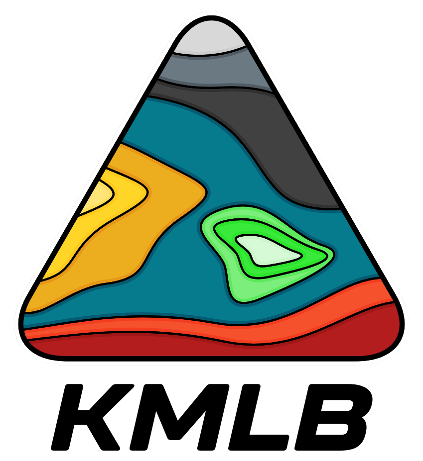
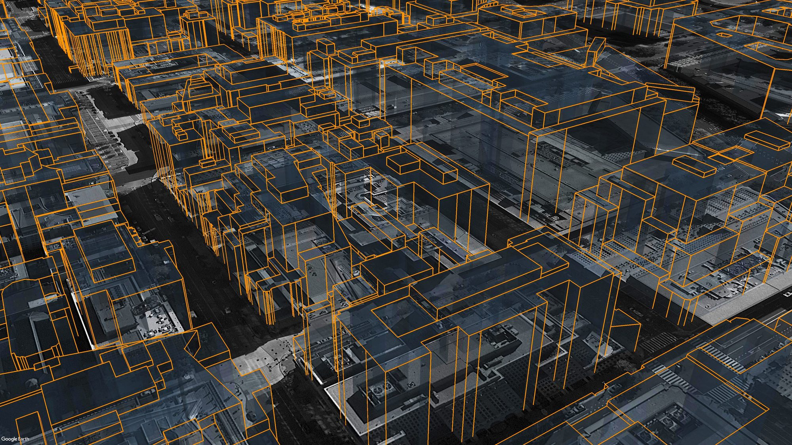

<p align="center">
  
</p>

# KMLB

### Plain Python KML Builder.

[](https://www.python.org/)
[](https://pypi.org/project/kmlb/)
[](https://github.com/HFM3/kmlb/blob/master/pypi_package/LICENSE)

KMLB is a dependency-free Python library for writing Google Earth KML files.
Easily create points, lines, polygons, styles, and folders.

Full documentation at [kmlb.dev](https://kmlb.dev/).

---

## Installation

```bash
pip install kmlb
```

Requires Python 3.9+. No third-party dependencies.

---

## Quick example

```python
import kmlb

# Define a reusable style and a styled point
style = kmlb.point_style("city", color=("#ff8800", 100), scale=1.4)
boston = kmlb.point([-71.0589, 42.3601], "Boston", style_to_use="city")

# Assemble a document and write it to disk
kmlb.kml("My Places", [boston], styles=[style], path="my_places.kml")
```

Open `my_places.kml` in [Google Earth](https://earth.google.com/) to view it.

---

<p align="center">
  
</p>

<p align="center"><sub>Building footprints extruded into 3D and viewed in Google Earth, built with kmlb polygons.</sub></p>

## Modules

| Module | Description |
|---|---|
| `kmlb` | Build points, POI/address searches, lines, polygons (with holes), point/line/polygon styles, folders, camera angles, and KML documents; geodesic `distance`, `bearing`, and `destination` |
| `kmlb.shapes` | Composite geometry: `wedge` (a pie-wedge polygon) |
| `kmlb.colors` / `kmlb.icons` | Named color presets and built-in marker shorthands for styling, so `color="red"` and `icon="triangle"` instead of hex tuples and full icon URLs |

The core builders are re-exported at the top level, so `kmlb.point(...)`,
`kmlb.kml(...)`, and friends work directly. See the
[reference](https://kmlb.dev/docs/reference/getting_started/) for every function.

---

## Example use

### Writing a basic KML file

```python
import kmlb

# CREATE A POINT
fountain = kmlb.point([-71.051904, 42.358988, 0], "Rings Fountain")

# WRITE KML FILE
kmlb.kml(
    "Boston Fountain",          # KML name
    [fountain],                 # Features
    path="folder/boston_fountain.kml"  # Export path
)
```

### Mapping a POI or an address

```python
import kmlb

# CREATE A POINT FROM A POI
bos_common = kmlb.search_poi("Boston Common, Boston, MA")

# CREATE A POINT FROM AN ADDRESS
ss = kmlb.search_poi("700 Atlantic Avenue, Boston, MA", name="South Station")

# WRITE KML FILE
kmlb.kml(
    "Boston Landmarks",          # KML name
    [bos_common, ss],            # Features
    path="folder/boston_landmarks.kml"  # Export path
)
```

### Creating a customized KML file

```python
import kmlb

# DEFINE A STYLE
pt_style = kmlb.point_style(
    "Red Triangle",                # Point style name
    icon="triangle",               # Icon (built-in shorthand)
    color=("#ff0000", 100),        # Icon color (hex, opacity)
    scale=1.0,                     # Icon scale
    label_color=("#ffffff", 100),  # Label color (hex, opacity)
    label_size=1.0,                # Label size
)

# CREATE A POINT
clock_tower = kmlb.point(
    [-71.053568, 42.359053, 151],                   # Coordinates
    "Custom House Tower",                           # Name
    headers=["City", "Building", "Height (M)"],     # Attribute titles
    attrs=["Boston", "Custom House Tower", "151"],  # Attributes
    z_mode="RTG",                                   # Relative To Ground
    style_to_use="Red Triangle",                    # Name of point style defined earlier
)

# WRITE KML FILE
kmlb.kml(
    "Boston Clock Tower",                     # KML name
    [clock_tower],                            # Features to include
    path="folder/boston_clock_tower.kml",     # Export path
    desc="Created with KMLB Python Package",  # KML description
    styles=[pt_style],                        # Styles to include
)
```

---

## Functions

| Function | What it does |
|---|---|
| **Features** | |
| `point` | Point placemark from a `[lon, lat]` (or `[lon, lat, elev]`) coordinate. |
| `search_poi` | Placemark located by an address or search string, geocoded by Google Earth. |
| `line` | Line or polyline from an ordered list of coordinates. |
| `polygon` | Polygon from one or more rings (first ring outer, the rest holes). |
| **Styles** | |
| `point_style` | Reusable point style: icon, color, scale, and label. |
| `line_style` | Reusable line style: color and width. |
| `polygon_style` | Reusable polygon style: fill and outline. |
| **Geodesy (WGS-84)** | |
| `distance` | Distance in meters between two coordinates. |
| `bearing` | Initial bearing in degrees between two coordinates. |
| `destination` | Coordinate reached from an origin along a bearing and distance. |
| **Shapes** | |
| `shapes.wedge` | Pie-wedge (circular sector) polygon, useful for cellular coverage sectors. |
| **Views, documents, and links** | |
| `look_at` | Camera angle and view for a feature or document. |
| `folder` | Group features and other folders together. |
| `kml` | Assemble features and styles into a KML document and write it to disk. |
| `networklink_kml` | Network-link KML that refreshes from a hosted URL. |
| **Color and icon helpers** | |
| `colors` | Named color palette (`colors.RED`, or `color="red"`). |
| `icons` | Built-in marker shorthands (`icon="triangle"`, `"red-paddle"`). |

---

## Citing KMLB

Using KMLB in research or published work? A citation is appreciated (it is not
required under the MIT license, but documented use builds trust in the tool).
APA, Chicago, and BibTeX formats, kept current with each release, are at
**[kmlb.dev/docs/cite](https://kmlb.dev/docs/cite/)**.

```bibtex
@software{KMLB,
  author  = {Mros, III, Henry F.},
  title   = {KMLB: KML Builder},
  year    = {2026},
  version = {0.1.0},
  url     = {https://pypi.org/project/kmlb/}
}
```

---

## License

[MIT](https://github.com/HFM3/kmlb/blob/master/pypi_package/LICENSE). Free to use, modify, and redistribute, including in commercial or
proprietary tools, as long as the copyright notice and license text are retained.
